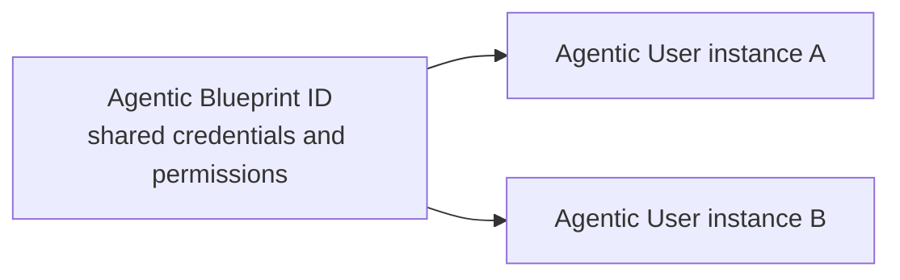

# Agentic Identity

<LanguageInclude section="availability-note" />

These guides show how to connect a Teams SDK app to an **Agentic User**—an AI teammate represented by its own Microsoft Entra user account.

## Identity model

An Agentic Blueprint defines the shared credentials and baseline permissions for a type of agent. One blueprint can be used to create multiple Agentic User instances.

One blueprint can support multiple independently managed Agentic Users while the same Teams SDK app handles their messages.

For background on blueprints, agent identities, and authentication modes, see [Agent 365 identity](https://learn.microsoft.com/microsoft-agent-365/developer/identity?view=o365-worldwide).

The guides show how to:

- Receive messages addressed to an Agentic User.
- Reply with the correct Agentic User identity.
- Send proactive messages with an explicit agent identity.
- Handle Agentic User lifecycle events.
- Add Agent 365 identity and correlation context to telemetry.
